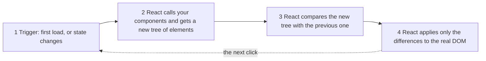

# What is React and why is it so relevant?

📘 **React**

React is a JavaScript **library for building user interfaces**: you describe what the screen should look like, piece by piece, and React keeps the real screen in step with that description. ⚛️

---

**You will learn to:**

- say what React is: a library for user interfaces that looks after the **view layer** only
- explain the difference between **imperative** and **declarative** code
- name the **four reasons** React matters: components, the declarative style, one-way data flow, and a virtual representation of the user interface

**Before you start:** you need basic JavaScript (variables, functions, objects). If any of that feels rusty, have a look at Albert's [JavaScript basics](https://albertprofe.dev/reactjs/reactjs-js-basics.html) and [functions](https://albertprofe.dev/reactjs/reactjs-js-functions.html) pages first. You don't need any React yet. ⏱️ About 40 minutes, exercises included.

## 1 Overview

Picture a Saturday market on the coast near Barcelona. 🧺 Every stall has a chalkboard with its prices and what is left: *tomatoes 2.50 €/kg, artichokes 3.20 €/kg, five kilos of tomatoes in stock*. Each time someone buys a kilo, the stallholder has to rub out a number and write a new one. On a quiet morning that is easy. On a busy one, with ten products and a queue of hungry neighbours, the board starts to lie: the stock says 3 kg, but the crate is empty. 😬

A web page has the same problem. The part of an app that people see and touch (text, buttons, lists, images) is called the **user interface**, or **UI** for short. In a modern app the data behind the UI changes all the time: a new message arrives, a price drops, someone adds an item to a basket. Every change means the screen must be updated, and it must be updated **correctly**, without reloading the whole page.

That is exactly the problem React was created to solve. It was first used in 2011 for Facebook's News Feed, created by the engineer Jordan Walke, and it was released to the public in 2013 ([Albert's introduction, §1.5](https://albertprofe.dev/reactjs/reactjs-what-principles.html)). Albert sums up its purpose well: React helps you build **large web applications that use data which can change over time, without reloading the page** ([§1.1](https://albertprofe.dev/reactjs/reactjs-what-principles.html)).

React's big idea fits on a sticky note:

> **You describe *what* the UI should look like for the data you have right now. React works out *how* to change the real screen to match.**

Hold on to that sentence. 🍵 Everything else in this course is a way of making that idea practical. In this lesson you'll meet the first two pieces: **JSX** (short for *JavaScript XML*; XML is a tag-based markup language, a close cousin of HTML), the way you write the description, and the **render cycle**, the loop React runs to keep the screen matching it.

> [!NOTE]
> I've written React since about 2014, back when components were written as JavaScript *classes*. Today React code is written with **function components** and **Hooks** (React functions whose names start with `use`; you'll meet the first one in Example 2), and that is all you'll see in this course.

## 2 The problem: keeping the screen in sync by hand

Before React, the usual way to update a page was to give the browser step-by-step orders. To understand those orders you need one more word.

📘 **DOM**: the **Document Object Model** is the browser's live, in-memory version of your page. Every heading, paragraph and button is an object in a tree, and JavaScript can create, change or remove those objects. When the DOM changes, the screen changes.

Here is a working tomato stall written in plain JavaScript, with no React at all. It shows the stock and a button that sells one kilo.

**`imperative.js`**

```js
const board = document.getElementById('imperative');
let stock = 5;

const title = document.createElement('h2');
title.textContent = 'Tomatoes (imperative)';

const label = document.createElement('p');
label.textContent = 'In stock: ' + stock + ' kg';

const button = document.createElement('button');
button.textContent = 'Sell 1 kg';

button.addEventListener('click', function () {
  stock = stock - 1;
  label.textContent = 'In stock: ' + stock + ' kg';
  if (stock === 0) {
    button.disabled = true;
  }
});

board.append(title, label, button);
```

What happens here, step by step:

1. You find an empty box on the page (`board`) and keep the stock in a variable.
2. You **create** each DOM object by hand: a heading, a paragraph and a button, and you fill in their text.
3. You **listen** for clicks on the button. On each click you lower the stock, then **you must remember** to rewrite the paragraph, and **you must remember** to disable the button at zero.
4. Finally you put the three objects into the box.

It works. 🙂 Run it on **StackBlitz**, an online editor that runs the whole project in your browser, with no installing: open the [imperative-vs-declarative example](https://stackblitz.com/github/AlbertProfe/React-curriculum/tree/drafts/examples/01-01/imperative-vs-declarative) and click until the tomatoes run out.

This style is called **imperative**: you give the browser orders, one after another, like a recipe written for a cook who has never seen a kitchen. 👨‍🍳 *Take the bread. Cut two slices. Toast them. Rub half a tomato on each. Add oil. Add salt.*

Now imagine the stall grows: a price that changes at noon, a "Sold out!" sign, a basket total, a list of ten products. Every new piece of data multiplies the places where you must remember to update the screen. Forget one line and the board lies, like the chalkboard at the busy stall. That gap between the data and the screen is where many UI bugs live.

**Question for you before reading on:** 🤔 if you could hire someone to keep the screen in sync for you, what would you want to tell them, and what would you rather not have to tell them?

## 3 The solution: React

React answers that question in a particular way. Instead of the recipe, you hand over a **picture of the finished plate**: *"pa amb tomàquet, please: two toasted slices, tomato, oil, salt."* 🍅🍞 The kitchen (React) decides which steps are needed to get from what is on the counter now to what you asked for.

This style is called **declarative**: you **declare the result** you want for the current data, and React does the step-by-step work.

### 3.1 A library, and only for the view

Two words in the opening card deserve a closer look.

- 📚 A **library** is a set of tools that *your* code calls when it needs them, like a good set of knives. A **framework** is more like a whole restaurant kitchen with its own rules: it decides the structure and calls *your* code. React is a library: it gives you tools for UI and stays out of the rest.
- 🪟 The **view layer** is the part of an application that shows things to people. React looks after the view and nothing else. Saving data, talking to a server, moving between pages or choosing colours and fonts are all jobs for other tools. You'll meet those in [lesson 1.3, What is not React](01-03-what-is-not-react.md).


*What React does, and the much larger world of things it leaves to other tools. Image by [Dave Ceddia](https://daveceddia.com/what-react-does/), as used on Albert's [JSX page, §4](https://albertprofe.dev/reactjs/reactjs-what-jsx.html).*

React itself comes in two packages. `react` knows how to describe a UI. `react-dom` knows how to put that description into a browser's DOM. (Other packages, such as React Native for phone apps, put the same kind of description onto other screens.)

### 3.2 Components: the stalls of your market

📘 **Component**: a reusable piece of UI. In React, a component is a **JavaScript function that returns a description of what to show**. A page is built by putting components inside other components, like stalls inside a market, and products inside each stall.

Because they are functions, you can name them, reuse them and combine them. Component names always start with a capital letter (`Tomatoes`, `App`), so React can tell them apart from plain **HTML** tags like `<li>`. (HTML, HyperText Markup Language, is the tag language every web page is written in.)

### 3.3 JSX: writing the picture of the plate

📘 **JSX**: a **syntax extension for JavaScript** that lets you write HTML-like tags **inside JavaScript**. It is not HTML: a build tool translates every JSX tag into a JavaScript function call that creates a **React element**.

📘 **React element**: a small, plain JavaScript object that describes one piece of UI, such as "a `<p>` with the text *In stock: 5 kg*". Elements are cheap to create and are only descriptions; on their own they don't touch the screen.

The mental model, straight from Albert's course outline:

> **JSX → React elements → component tree**

You'll go deep into JSX's rules in [lesson 1.2](01-02-jsx-describing-the-ui.md). For now, notice one thing: inside JSX, curly braces `{ }` open a little window back into JavaScript, so `{stock}` shows the current value of `stock`. ✨

### 3.4 The render cycle

📘 **Render**: when React **calls your component function** to get a fresh description of the UI. The first time is the *initial render*; every later one is a *re-render*.

📘 **State**: data that a component remembers and that can change over time, such as the stock of tomatoes. When state changes, React re-renders. (State gets its own lesson: [3.1](03-01-state-component-memory.md).)

Every time the data changes, React goes round the same loop. 🔁



<!-- image: a hand-drawn version of this render-cycle loop with the tomato stall (no matching image exists in references/; mermaid rendering is an open question for Albert) -->

1. **Trigger.** Something asks for a render: the app starts, or a piece of state changes.
2. **Render.** React calls your component functions: all of them on the first render, and afterwards the component whose state changed, plus the components inside it. Each one returns JSX, which becomes a tree of React elements.
3. **Compare.** React compares the new tree with the one from the last render and works out what changed.
4. **Update.** React changes only those parts of the real DOM. If nothing changed, it touches nothing. The rest of the page is left alone.

> [!IMPORTANT]
> You never write steps 2 to 4 yourself. Your job is to **describe the UI for the current data**; React's job is to **make the real screen match**. react.dev calls steps 2–3 *render* and step 4 *commit*; you'll study them in [lesson 3.2, Render and commit](03-02-render-and-commit.md) and on react.dev's [Render and Commit](https://react.dev/learn/render-and-commit) page.

## 4 Example 1: your first React screen

Time for working code. 🧑‍🍳 You'll build a tiny market board with two products. Open the [hello-market example on StackBlitz](https://stackblitz.com/github/AlbertProfe/React-curriculum/tree/drafts/examples/01-01/hello-market) and keep it next to this page.

Every example in this course is a small **Vite** project. Vite is a **build tool**: a program that, while you work, translates your JSX into plain JavaScript the browser understands and serves your app on a local address. The first file that runs is `main.jsx`.

**`main.jsx`**

```jsx
import { StrictMode } from 'react';
import { createRoot } from 'react-dom/client';
import App from './App.jsx';

createRoot(document.getElementById('root')).render(
  <StrictMode>
    <App />
  </StrictMode>
);
```

1. You import `createRoot` from `react-dom/client`: the bridge between React and the browser's DOM.
2. `document.getElementById('root')` finds an empty `<div id="root">` in `index.html`. That `div` is the **root**: the one spot on the page that React will look after.
3. `.render(<App />)` asks React to render your top component, `App`, inside the root. This is the **initial render** from the cycle above.
4. `StrictMode` is a development helper that checks your components for common mistakes. It shows nothing on screen; you'll see why it exists in [lesson 1.5, Purity](01-05-purity.md).

Now the market board itself.

**`App.jsx`**

```jsx
function Tomatoes() {
  return <li>🍅 Tomatoes · 2.50 € / kg</li>;
}

function Artichokes() {
  return <li>🌿 Artichokes · 3.20 € / kg</li>;
}

export default function App() {
  const stallName = "Tom's vegetable stall";

  return (
    <main>
      <h1>{stallName}</h1>
      <ul>
        <Tomatoes />
        <Artichokes />
      </ul>
    </main>
  );
}
```

1. `Tomatoes` and `Artichokes` are **components**: plain `function` declarations, with a capital letter, that return JSX.
2. `App` is the top component. `export default` lets `main.jsx` import it (see Albert's [import modules page](https://albertprofe.dev/reactjs/reactjs-es6-import.html) if `export` is new to you).
3. Inside `App`, `stallName` is an ordinary JavaScript variable, and `{stallName}` puts its value into the heading.
4. `<Tomatoes />` and `<Artichokes />` **use** the components, the same way you use an HTML tag. React calls those functions too and puts their `<li>` elements inside the `<ul>`.

What you see in the browser is a heading, *Tom's vegetable stall*, and a list with two products.

<!-- screenshot: the hello-market example in the browser, showing the heading and the two-item list -->

Look at the shape of the code and you'll see a **tree**: `App` at the top, with `Tomatoes` and `Artichokes` as its children. That is the **component tree**, the subject of [lesson 1.4](01-04-component-tree-rendering.md).

## 5 Example 2: the same stall, declarative

Here is the tomato stall from section 2 again, rebuilt with React and placed side by side with the plain version. Both live in the same project: [imperative-vs-declarative on StackBlitz](https://stackblitz.com/github/AlbertProfe/React-curriculum/tree/drafts/examples/01-01/imperative-vs-declarative). Click both buttons and watch them behave the same way.

The React version needs one new word.

📘 **Hook**: a special React function whose name starts with `use`. Calling a Hook inside your component lets it plug into a React feature. `useState` is the Hook that gives a component **state**, its own memory. You'll study it properly in [lesson 3.1](03-01-state-component-memory.md); here you only need to read it.

**`App.jsx`**

```jsx
import { useState } from 'react';

export default function App() {
  const [stock, setStock] = useState(5);

  function handleSell() {
    setStock(stock - 1);
  }

  return (
    <section>
      <h2>Tomatoes (declarative)</h2>
      <p>In stock: {stock} kg</p>
      <button onClick={handleSell} disabled={stock === 0}>
        Sell 1 kg
      </button>
    </section>
  );
}
```

1. `useState(5)` gives the component a piece of state that starts at `5`. It hands back two things: the current value, `stock`, and a function to change it, `setStock`.
2. `handleSell` is an **event handler**: a function that runs when something happens, here a click. It asks React to set the stock to one less.
3. The `return` describes the stall **for any value of `stock`**: the paragraph shows `{stock}`, and the button is disabled when `stock === 0`.
4. `onClick={handleSell}` hands the function to the button so React can call it on each click (passing versus calling a function is the topic of [lesson 2.4](02-04-events-and-handlers.md)).

Now follow one click round the render cycle. 🔁

1. **Trigger:** you click, `handleSell` runs, and `setStock(4)` tells React the state changed.
2. **Render:** React calls `App` again. This time `stock` is `4`, so the JSX describes "In stock: 4 kg".
3. **Compare:** React compares the new description with the old one. The heading is the same; the button is still enabled; only the number in the paragraph changed.
4. **Update:** React changes that one piece of text in the real DOM.

Compare this with `imperative.js`. There, the click handler had to **remember** every part of the screen that depends on `stock`. Here, the click handler only **changes the data**; the description in `return` already says what the screen looks like for every possible stock. Add a new piece of UI that depends on `stock` and you write it once, in the description, and it can never fall out of step. 🎯

> [!TIP]
> A handy way to remember it: in React, **the UI is a function of the data**. Same data in, same picture out. Dalí's clocks may melt, but they melt the same way every time you look at the painting. 🕰️

> [!NOTE]
> Prefer your own computer to StackBlitz? Download the example folder, then run `npm install` and `npm run dev` inside it (npm is the package manager that comes with Node.js). To start a fresh project of your own with Vite, run `npm create vite@latest my-app -- --template react`. (react.dev's [Build a React App from Scratch](https://react.dev/learn/build-a-react-app-from-scratch) lists Vite among a few build tools, and its snippet uses the TypeScript template `react-ts`; this course sticks to plain JavaScript, so you use `react`.)

## 6 Back to the whole: four reasons React matters

Step back from the code and look at the market again. 🌅 Albert's course outline gives four reasons why React became so relevant. You have already met each of them in this lesson.

| Reason | What it means | Where you saw it |
|---|---|---|
| 🧩 **Component model** → reusable and composable | UI is built from small functions you can name, reuse and nest | `Tomatoes`, `Artichokes` inside `App` (Example 1) |
| 🖼️ **Declarative style** → fewer bugs | you describe the result for the current data; React does the steps, so there are fewer places to forget an update | the React stall vs `imperative.js` (Example 2) |
| ⬇️ **One-way (unidirectional) data flow** → predictable | data flows **down** the component tree, from parents to children, so you can always find where a value comes from | `stock` lives in `App` and flows down into the JSX it returns; passing it on to child components comes with props in lesson 2.1 |
| 🪞 **Virtual representation of the UI** → fast updates | React keeps a lightweight description of the UI in memory, compares versions, and touches only what changed in the real DOM | steps 2–4 of the render cycle |

A word on the last row. For years this in-memory description was called the **virtual DOM** (sometimes written VDOM), and you'll see that name on Albert's [render and virtual DOM page](https://albertprofe.dev/reactjs/reactjs-what-render-dom.html) and in many articles. The idea is the same one you followed in the render cycle:


*The virtual DOM loop. "Diffing" means comparing the old and new trees; "reconciliation" is React's name for that whole comparison process; a component "marked dirty" is one that needs to re-render. Image from Albert's [render and virtual DOM page](https://albertprofe.dev/reactjs/reactjs-what-render-dom.html).*

> [!NOTE]
> You'll notice react.dev's current docs rarely say "virtual DOM". Why? Look at what they say instead. They describe the steps from the point of view of *your* code: something **triggers** a render, React **renders** (calls your components), and React **commits** the differences to the DOM ([Render and Commit](https://react.dev/learn/render-and-commit)). That is the same loop, told with words you can see in your own components. This course uses the render-and-commit words from lesson 3.2 onwards.

The third row, one-way data flow, deserves one more market picture. The stallholder decides the price and writes it on every label. A label never changes the price list on its own; a customer who wants a discount **asks** the stallholder. In React, a parent component passes data down to its children (through **props**, [lesson 2.1](02-01-passing-props.md)), and a child that wants a change asks the parent through a function. react.dev's [Thinking in React](https://react.dev/learn/thinking-in-react) builds a whole small app this way; read it once you've finished Module 02.

So, what is React? A **library** for the **view layer** that lets you **describe** your UI as a **tree of components**, written in **JSX**, and that runs the **render cycle** to keep the real screen in step with your data. 🌳

## 7 Recap

- **UI** is everything on screen; the **DOM** is the browser's live object tree behind it.
- React is a **library** for UIs that cares only about the **view layer**.
- **Imperative** code gives step-by-step orders; **declarative** code describes the result. React is declarative.
- A **component** is a function that returns **JSX**; JSX becomes **React elements**, which form the **component tree**.
- **Render cycle:** trigger → render (call components) → compare → update only what changed.
- Four reasons React matters: **components**, **declarative style**, **one-way data flow**, **virtual representation** of the UI.

## 8 Try it

Take your time. If something feels foggy, step back to section 1, make a cup of tea, and come back. 🍵

### 8.1 Extend a component

Open [hello-market](https://stackblitz.com/github/AlbertProfe/React-curriculum/tree/drafts/examples/01-01/hello-market). Add a third product to the board: a `Calcots` component that shows `🧅 Calçots · 4.00 € / bunch`. Make it appear **between** the tomatoes and the artichokes.

<details>
<summary>Solution</summary>

**`App.jsx`**

```jsx
function Tomatoes() {
  return <li>🍅 Tomatoes · 2.50 € / kg</li>;
}

function Calcots() {
  return <li>🧅 Calçots · 4.00 € / bunch</li>;
}

function Artichokes() {
  return <li>🌿 Artichokes · 3.20 € / kg</li>;
}

export default function App() {
  const stallName = "Tom's vegetable stall";

  return (
    <main>
      <h1>{stallName}</h1>
      <ul>
        <Tomatoes />
        <Calcots />
        <Artichokes />
      </ul>
    </main>
  );
}
```

You declare a new function with a capital letter, then use it as `<Calcots />` in the place where you want it. The order of the tags in the JSX is the order on screen. The component name is spelled without the `ç` so it's easy to type on any keyboard; the text inside the `<li>` can use any characters you like.

</details>

### 8.2 Count the places

Open [imperative-vs-declarative](https://stackblitz.com/github/AlbertProfe/React-curriculum/tree/drafts/examples/01-01/imperative-vs-declarative). In **both** versions, make the paragraph say `Sold out! 🧺` when the stock reaches zero. Then count: in each version, how many places did you have to change?

<details>
<summary>Solution</summary>

**`imperative.js`**

```js
const board = document.getElementById('imperative');
let stock = 5;

const title = document.createElement('h2');
title.textContent = 'Tomatoes (imperative)';

const label = document.createElement('p');
label.textContent = 'In stock: ' + stock + ' kg';

const button = document.createElement('button');
button.textContent = 'Sell 1 kg';

button.addEventListener('click', function () {
  stock = stock - 1;
  label.textContent = 'In stock: ' + stock + ' kg';
  if (stock === 0) {
    button.disabled = true;
    label.textContent = 'Sold out! 🧺';
  }
});

board.append(title, label, button);
```

**`App.jsx`**

```jsx
import { useState } from 'react';

export default function App() {
  const [stock, setStock] = useState(5);

  function handleSell() {
    setStock(stock - 1);
  }

  let message = 'In stock: ' + stock + ' kg';
  if (stock === 0) {
    message = 'Sold out! 🧺';
  }

  return (
    <section>
      <h2>Tomatoes (declarative)</h2>
      <p>{message}</p>
      <button onClick={handleSell} disabled={stock === 0}>
        Sell 1 kg
      </button>
    </section>
  );
}
```

Imperative: you change the **click handler**, and you must know *when* to rewrite the label (add a "restock" button later and the label can go wrong). React: you change the **description** of what the paragraph shows for any stock, and the click handler stays untouched. More ways to choose what to show come in [lesson 2.2, Conditional rendering](02-02-conditional-rendering.md).

</details>

### 8.3 Draw the render cycle

First, predict: 🔮 starting from 5 kg, what does the React stall show after **five** clicks, and what happens when you try a sixth?

Then, on paper, draw the four steps of the render cycle for **one click** on "Sell 1 kg" in the React stall, going from 3 kg to 2 kg. Label each arrow with what happens, and circle the one part of the real DOM that changes.

<details>
<summary>Solution</summary>

**Prediction:** after five clicks the paragraph says *In stock: 0 kg* and the button is disabled, because the description says `disabled={stock === 0}`. A disabled button doesn't fire clicks, so the sixth try triggers nothing: no trigger, no render.

**Drawing:**

1. **Trigger:** the click runs `handleSell`, which calls `setStock(2)`.
2. **Render:** React calls `App`; with `stock` equal to `2`, the JSX describes a heading, a paragraph "In stock: 2 kg" and an enabled button.
3. **Compare:** against the previous description, only the number in the paragraph is different.
4. **Update:** React changes that text in the real DOM. Circle the `2`. The heading and the button are not touched.

Your drawing may look different: a circle, a clock, a market conveyor belt. 🎨 What matters is that it loops back to step 1 for the next click.

</details>

### 8.4 Explain it back

In **three sentences**, explain to a friend who has never coded what React is. Use the words *UI*, *component* and *declarative*, and explain each one as you go.

<details>
<summary>One possible answer</summary>

"The UI is everything you see and touch on an app's screen. React is a tool that lets you build that UI out of small, reusable pieces called components, like stalls that together make a market. It's declarative: you describe what the screen should look like for the data you have, and React works out how to change the screen when the data changes."

</details>

### 8.5 Debate in class 🗣️

Pick one and argue **both** sides with a classmate.

1. "React is a library, not a framework." Does that difference matter to you as a developer, or is it only a label?
2. For years web developers kept HTML, CSS (Cascading Style Sheets, the language for colours and layout) and JavaScript in separate files. JSX puts markup and logic in the same component. Is that a step forward or a step back? (Albert's [JSX page, §2–3](https://albertprofe.dev/reactjs/reactjs-what-jsx.html) gives one side.)
3. Can you think of a situation where writing imperative code is still the right choice?

<details>
<summary>Points to consider</summary>

1. With a library, *you* decide how the app is organised and which other tools to add (routing, data fetching, styling). That gives freedom, and it also means more decisions. Frameworks built on top of React make many of those decisions for you.
2. The old split was by **technology** (HTML here, JavaScript there). Components split by **piece of UI** instead: everything about the tomato stall lives in one place. Ask yourself which split makes it easier to find and fix a bug in one stall.
3. Declarative code still runs on imperative steps underneath: React's own job in step 4 is imperative DOM work. Some tasks need direct steps, such as moving focus into a text box or drawing on a canvas; React has "escape hatches" for them, which are beyond this course's core.

</details>

## References

- Albert: [React JS: Introduction](https://albertprofe.dev/reactjs/reactjs-what-principles.html) (§1.1–1.2, §1.5)
- Albert: [React JS: render virtual DOM](https://albertprofe.dev/reactjs/reactjs-what-render-dom.html)
- Albert: [React JS: JSX](https://albertprofe.dev/reactjs/reactjs-what-jsx.html) (§2–4)
- Albert: [React JS: Components](https://albertprofe.dev/reactjs/reactjs-what-components.html)
- react.dev: [Quick Start](https://react.dev/learn)
- react.dev: [Thinking in React](https://react.dev/learn/thinking-in-react)
- react.dev: [Writing Markup with JSX](https://react.dev/learn/writing-markup-with-jsx)
- react.dev: [Render and Commit](https://react.dev/learn/render-and-commit)
- react.dev: [Build a React App from Scratch](https://react.dev/learn/build-a-react-app-from-scratch)
- Dave Ceddia: [What React Does (and Doesn't Do)](https://daveceddia.com/what-react-does/) (source of the "Things React does" image)
