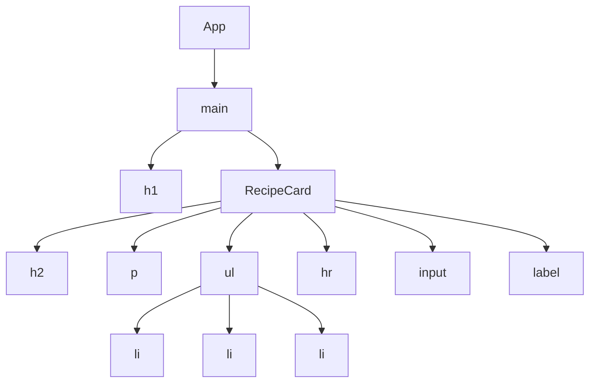

# JSX: describing the UI

📘 **JSX**

JSX is a syntax extension for JavaScript: it lets you write HTML-like tags inside a JavaScript file to **describe what a component shows**. A build tool then turns every tag into plain JavaScript. 🏷️

---

**You will learn to:**

- read and write JSX
- apply the three JSX rules: **one root element**, **every tag closed**, **camelCase attributes**
- use curly braces `{ }` to put JavaScript values into JSX
- explain the journey **JSX → React elements → tree**

**Before you start:** [lesson 1.1, What is React](01-01-what-is-react.md), where you wrote your first components. The examples use JavaScript objects and dot notation (`recipe.name`); Albert's [objects page](https://albertprofe.dev/reactjs/reactjs-js-objects.html) is a good refresher. ⏱️ About 35 minutes, exercises included.

## 1 Overview

In lesson 1.1 you already wrote JSX without much ceremony: `<li>🍅 Tomatoes · 2.50 € / kg</li>` inside a function. It looked like HTML (HyperText Markup Language, the tag language of every web page), and it worked. Now it's time to look at it properly, the way a cook looks at a knife after using it for a week. 🔪

Why tags inside JavaScript at all? For years, web developers kept **content** in HTML files, **design** in CSS files (Cascading Style Sheets, the language for colours and layout) and **logic** in JavaScript files. That split works for a page that rarely changes. In an app whose screen depends on data, the logic and the markup are always talking to each other, and keeping them in different files is like keeping the recipe in one kitchen and the ingredients in another. Albert's [JSX page, §2–3](https://albertprofe.dev/reactjs/reactjs-what-jsx.html) makes the case: in React, **a component keeps its data, its logic and its markup together**, in one self-contained piece.


*One component, three jobs: JavaScript for data and logic (green), JSX for the markup (orange), and curly braces that inject the data into the markup (blue). Diagram from Albert's [JSX page, §3](https://albertprofe.dev/reactjs/reactjs-what-jsx.html).*

Keep that picture in mind. By the end of this lesson you'll be able to read every part of it. 🧭

## 2 The problem: HTML is not quite JSX

Imagine you find a recipe card on an old website and want to turn it into a React component. Here is its HTML. It is valid HTML, and any browser shows it happily.

**`recipe.html`**

```html
<!doctype html>
<html lang="en">
<meta charset="UTF-8">
<title>Pa amb tomàquet</title>
<h2 class="title">Pa amb tomàquet 🍅</h2>
<p>Ready in 10 minutes<br>Serves 2</p>
<ul>
  <li>2 slices of rustic bread
  <li>1 ripe tomato
  <li>Olive oil and salt
</ul>
<hr>
<input type="checkbox" id="toasted">
<label for="toasted">The bread is toasted</label>
```

You can open it from the [recipe-card example](https://stackblitz.com/github/AlbertProfe/React-curriculum/tree/drafts/examples/01-02/recipe-card) by adding `/recipe.html` to the preview address.

**Question for you:** 🤔 copy everything from `<h2>` to `</label>` into a component's `return ( ... )`. Will it work? Look for three habits that HTML forgives and a JavaScript file might not.

If you try it, Vite stops with an error before anything reaches the screen. HTML browsers are generous hosts: they close your `<li>` tags for you and accept `<br>` with no partner. JSX is stricter, because it is not HTML. It has to become JavaScript, and JavaScript needs everything spelled out.

## 3 The solution: the three rules of JSX, and one window

### 3.1 The three rules

Albert's [JSX page, §5](https://albertprofe.dev/reactjs/reactjs-what-jsx.html) and react.dev's [Writing Markup with JSX](https://react.dev/learn/writing-markup-with-jsx) agree on three rules. Each one has a reason behind it. 🧐

| Rule | ❌ HTML habit | ✅ JSX |
|---|---|---|
| 1. Return **one root element** | `<h2>…</h2><p>…</p>` side by side | wrap them: `<div>…</div>` or `<>…</>` |
| 2. **Close every tag** | `<li>bread`, `<br>`, `<hr>`, `<input …>` | `<li>bread</li>`, `<br />`, `<hr />`, `<input … />` |
| 3. **camelCase** most attributes | `class`, `for`, `onclick` | `className`, `htmlFor`, `onClick` |

**Why one root?** A JavaScript function returns **one value**. Your JSX becomes one JavaScript object (you'll see it in section 6), so two tags side by side would be two values, and a function can't return two. Wrap them in a parent. If you don't want an extra `<div>` on the page, use a **Fragment**: the empty tags `<>` and `</>`. A Fragment groups tags for React and leaves no trace in the page.

**Why close every tag?** HTML guesses where an unclosed tag ends; JSX never guesses. Tags with content need a closing tag, and tags with no content (like `<br>`, `<hr>`, ``, `<input>`) close themselves with a slash: `<br />`.

**Why camelCase?** **camelCase** means joining words and starting each new one with a capital: `tabIndex`, `onClick`. JSX attributes become keys of a JavaScript object, and JavaScript names can't contain dashes. Two names change completely, because they are **reserved words** in JavaScript (words the language keeps for itself): `class` becomes `className`, and `for` becomes `htmlFor`.

> [!NOTE]
> There is a historical exception: `aria-*` attributes (for accessibility) and `data-*` attributes keep their dashes, exactly as in HTML.

> [!TIP]
> Converting a big piece of HTML by hand gets tedious. react.dev points to an online [HTML-to-JSX converter](https://transform.tools/html-to-jsx). Use it, then read the result so you understand every change.

### 3.2 Curly braces: a window into JavaScript

The rules make JSX valid. Curly braces make it **alive**. 🪟

Inside JSX, `{ }` opens a window back into JavaScript. Whatever you put inside is worked out, and its **value** goes into the markup. You can open the window in two places:

1. **As text** between tags: `<h2>{recipe.name}</h2>`.
2. **As an attribute value**, right after the `=`: `<input id={recipe.id} />`.

What fits through the window is a JavaScript **expression**: any piece of code that produces a value. A variable (`recipe.name`), some maths (`recipe.serves * 2`), a function call (`recipe.name.toUpperCase()`): all expressions. Statements such as `if` or `for` don't produce a value, so they stay **outside** the JSX, above the `return` (you'll see how in [lesson 2.2](02-02-conditional-rendering.md)).

Quotes and braces mean different things in attributes:

- `className="title"`: quotes pass a **fixed string**, the word *title*.
- `id={recipe.id}`: braces pass the **value** of `recipe.id`.
- `id="{recipe.id}"`: quotes win, and the attribute is the literal text `{recipe.id}`. A classic slip. 🙃

> [!IMPORTANT]
> **Quotes for fixed text, braces for JavaScript values.** That one sentence covers most of what curly braces do.

## 4 Example 1: the recipe card in JSX

Here is the HTML card from section 2, converted to a component. Open the [recipe-card example on StackBlitz](https://stackblitz.com/github/AlbertProfe/React-curriculum/tree/drafts/examples/01-02/recipe-card).

**`RecipeCard.jsx`**

```jsx
export default function RecipeCard() {
  return (
    <>
      <h2 className="title">Pa amb tomàquet 🍅</h2>
      <p>Ready in 10 minutes<br />Serves 2</p>
      <ul>
        <li>2 slices of rustic bread</li>
        <li>1 ripe tomato</li>
        <li>Olive oil and salt</li>
      </ul>
      <hr />
      <input type="checkbox" id="toasted" />
      <label htmlFor="toasted">The bread is toasted</label>
    </>
  );
}
```

1. **Rule 1:** six tags sit side by side, so a Fragment, `<>` … `</>`, wraps them into one root.
2. **Rule 2:** every `<li>` gets its `</li>`, and `<br />`, `<hr />` and `<input />` close themselves.
3. **Rule 3:** `class` became `className` and `for` became `htmlFor`. In the browser they appear as the usual `class` and `for`.
4. The parentheses after `return` let the JSX start on the next line. Without them, JavaScript would end the `return` at the line break and return nothing.

**`App.jsx`**

```jsx
import RecipeCard from './RecipeCard.jsx';

export default function App() {
  return (
    <main>
      <h1>Tom's recipe box</h1>
      <RecipeCard />
    </main>
  );
}
```

1. `App` imports `RecipeCard` from its own file. One component per file is the usual habit (more in [lesson 1.4](01-04-component-tree-rendering.md)).
2. `<main>` is `App`'s single root. Inside it, `<RecipeCard />` places the whole card. Because the card uses a Fragment, its six tags land directly inside `<main>`, with no extra wrapper.

<!-- screenshot: the recipe-card example, showing the heading, the card text, the list and the checkbox -->

## 5 Example 2: curly braces at work

Now the data moves out of the markup and into a JavaScript object, and curly braces bring it back in. Open the [curly-braces example on StackBlitz](https://stackblitz.com/github/AlbertProfe/React-curriculum/tree/drafts/examples/01-02/curly-braces). Today's dish is escalivada, roasted Catalan vegetables. 🍆🫑

**`App.jsx`**

```jsx
const recipe = {
  id: 'escalivada',
  name: 'Escalivada',
  minutes: 45,
  serves: 4,
  colour: 'darkred',
};

export default function App() {
  return (
    <article>
      <h2 style={{ color: recipe.colour }}>{recipe.name}</h2>
      <p>Ready in {recipe.minutes} minutes · serves {recipe.serves}</p>
      <p>Cooking for a party? A double batch serves {recipe.serves * 2}.</p>
      <p>Shout it across the market: {recipe.name.toUpperCase()}! 📣</p>
      <input type="checkbox" id={recipe.id} />
      <label htmlFor={recipe.id}>I've roasted the vegetables</label>
    </article>
  );
}
```

1. `recipe` is an ordinary JavaScript object, written outside the component.
2. `{recipe.name}` in the `<h2>` is a window used **as text**. The same goes for `{recipe.minutes}` and `{recipe.serves}`, mixed freely with normal words.
3. `{recipe.serves * 2}` does maths, and `{recipe.name.toUpperCase()}` calls a function. Both are expressions, so the page shows *8* and *ESCALIVADA*.
4. `id={recipe.id}` and `htmlFor={recipe.id}` are windows used **as attribute values**. Change the `id` in the object and both attributes follow.
5. `style={{ color: recipe.colour }}` looks like a strange double window. It isn't: the outer braces open the window, and the inner braces are a JavaScript **object**, `{ color: 'darkred' }`. The `style` attribute wants an object of CSS properties, written in camelCase (`backgroundColor`, not `background-color`).

> [!NOTE]
> Inline `style` objects work, but CSS classes with `className` are the more common choice. How a component *looks* is CSS's job, not React's, as you'll see in [lesson 1.3, What is not React](01-03-what-is-not-react.md).

> [!WARNING]
> Not every value can go through the window as text. Strings and numbers show up on screen; `true`, `false`, `null` and `undefined` show nothing; and a whole object such as `{recipe}` makes React stop with an error, because React doesn't know how you want an object displayed. Pick the property you mean: `{recipe.name}`.

## 6 Back to the whole: from JSX to elements to the tree

Step back and look again at the coloured diagram from section 1. You can now read every box. One question is left: **what does JSX become?** 🌱

The browser has never heard of JSX. Before your code runs, Vite translates each JSX tag into a call to a React function that builds a **React element**: the small JavaScript object from lesson 1.1 that *describes* one piece of UI. The classic name of that function is [`createElement`](https://react.dev/reference/react/createElement), and you can call it yourself to see the two ways side by side. Open the [jsx-to-elements example on StackBlitz](https://stackblitz.com/github/AlbertProfe/React-curriculum/tree/drafts/examples/01-02/jsx-to-elements).

**`App.jsx`**

```jsx
import { createElement } from 'react';

function TitleWithJsx() {
  return <h2 className="title">Pa amb tomàquet</h2>;
}

function TitleWithoutJsx() {
  return createElement('h2', { className: 'title' }, 'Pa amb tomàquet');
}

export default function App() {
  return (
    <main>
      <TitleWithJsx />
      <TitleWithoutJsx />
    </main>
  );
}
```

1. `TitleWithJsx` uses the JSX you know.
2. `TitleWithoutJsx` builds the same element by hand: `createElement` takes the **type** (`'h2'`), the **props**, an object with the attributes (`{ className: 'title' }`), and the **children**, what goes inside (`'Pa amb tomàquet'`).
3. The page shows two identical headings. JSX is a friendlier way of writing the same call. (Today's Vite setup uses a newer function with the same job, but the idea is identical.)

**`main.jsx`**

```jsx
import { StrictMode } from 'react';
import { createRoot } from 'react-dom/client';
import App from './App.jsx';

const element = <h2 className="title">Pa amb tomàquet</h2>;
console.log(element);

createRoot(document.getElementById('root')).render(
  <StrictMode>
    <App />
  </StrictMode>
);
```

1. A line of JSX is stored in a normal `const`, because it *is* a normal JavaScript value.
2. `console.log` prints it in the browser's console (in StackBlitz, open the **Console** panel below the preview). You'll see an object with `type: "h2"` and `props: { className: "title", children: "Pa amb tomàquet" }`, plus a few fields with odd names that React uses internally.

This is the journey from Albert's course outline, now with something you've seen at every step:

> **JSX → React elements → component tree**

Every component returns elements; elements contain other elements and components; and together they form a **tree**. Here is the tree for the recipe box from Example 1:



The Fragment doesn't appear: it groups, and then it steps aside. This tree is what React renders, compares and updates in the render cycle you met in lesson 1.1. You'll draw trees like this one in [lesson 1.4](01-04-component-tree-rendering.md). 🌳

So JSX isn't HTML in disguise. It is a **description** written in a familiar shape, which becomes **objects**, which grow into a **tree**. Like a Dalí elephant on spider legs: it looks like one thing and is built from something else entirely. 🐘

## 7 Recap

- **JSX** lets you describe UI with HTML-like tags inside JavaScript; it is not HTML.
- **Three rules:** one root element (or a Fragment `<>…</>`), every tag closed, camelCase attributes (`className`, `htmlFor`).
- **Curly braces** open a window to JavaScript, as text or as an attribute value. **Quotes for fixed text, braces for values.**
- Only **expressions** fit inside `{ }`; `if` and `for` stay above the `return`.
- **JSX → React elements → tree:** each tag becomes a plain object, and the objects form the tree React renders.

## 8 Try it

Stuck? Step back to the diagram in section 1, pour a cup of tea, and come back. 🍵

### 8.1 Convert a stall sign

Here is the sign of a fish stall, copied from an HTML page. Turn it into a `StallSign` component in a new file, `StallSign.jsx`, inside the [recipe-card example](https://stackblitz.com/github/AlbertProfe/React-curriculum/tree/drafts/examples/01-02/recipe-card), and show it in `App` under the recipe card.

**`stall.html`**

```html
<h3 class="stall">Can Pep's fish stall 🐟</h3>
<p>Open from 8:00<br>Closed on Mondays</p>
<input type="checkbox" id="ice">
<label for="ice">Extra ice</label>
```

<details>
<summary>Solution</summary>

**`StallSign.jsx`**

```jsx
export default function StallSign() {
  return (
    <>
      <h3 className="stall">Can Pep's fish stall 🐟</h3>
      <p>Open from 8:00<br />Closed on Mondays</p>
      <input type="checkbox" id="ice" />
      <label htmlFor="ice">Extra ice</label>
    </>
  );
}
```

**`App.jsx`**

```jsx
import RecipeCard from './RecipeCard.jsx';
import StallSign from './StallSign.jsx';

export default function App() {
  return (
    <main>
      <h1>Tom's recipe box</h1>
      <RecipeCard />
      <StallSign />
    </main>
  );
}
```

All three rules in action: a Fragment for the four side-by-side tags, `<br />` and `<input />` closed, and `class` and `for` renamed to `className` and `htmlFor`.

</details>

### 8.2 Price the escalivada

In the [curly-braces example](https://stackblitz.com/github/AlbertProfe/React-curriculum/tree/drafts/examples/01-02/curly-braces), add `pricePerServing: 1.5` to the `recipe` object. Then add a paragraph that shows the price for the whole dish, with two decimals: *Price for 4: 6.00 €*. Hint: numbers have a `toFixed(2)` method.

<details>
<summary>Solution</summary>

**`App.jsx`**

```jsx
const recipe = {
  id: 'escalivada',
  name: 'Escalivada',
  minutes: 45,
  serves: 4,
  colour: 'darkred',
  pricePerServing: 1.5,
};

export default function App() {
  return (
    <article>
      <h2 style={{ color: recipe.colour }}>{recipe.name}</h2>
      <p>Ready in {recipe.minutes} minutes · serves {recipe.serves}</p>
      <p>Cooking for a party? A double batch serves {recipe.serves * 2}.</p>
      <p>Shout it across the market: {recipe.name.toUpperCase()}! 📣</p>
      <p>Price for {recipe.serves}: {(recipe.pricePerServing * recipe.serves).toFixed(2)} €</p>
      <input type="checkbox" id={recipe.id} />
      <label htmlFor={recipe.id}>I've roasted the vegetables</label>
    </article>
  );
}
```

The whole calculation, `(recipe.pricePerServing * recipe.serves).toFixed(2)`, is one expression, so it fits in one window. The inner parentheses make the multiplication happen before `toFixed`. Try changing `serves` to 6 and watch both the servings and the price follow.

</details>

### 8.3 Predict the screen 🔮

Without running it, write down what each paragraph shows. Then paste it into `App.jsx` in the curly-braces example and check.

**`App.jsx`**

```jsx
const stall = { name: 'Can Pep', kilos: 3 };

export default function App() {
  return (
    <section>
      <p>{stall.name}</p>
      <p>stall.name</p>
      <p>{'stall.name'}</p>
      <p>{stall.kilos + 2} kg</p>
      <p>Open today? {true}</p>
    </section>
  );
}
```

<details>
<summary>Solution</summary>

1. **Can Pep**: the window shows the value of `stall.name`.
2. **stall.name**: no braces, so it's plain text.
3. **stall.name**: the braces hold a string in quotes, and the value of a string is itself.
4. **5 kg**: the maths happens inside the window.
5. **Open today?** and nothing after it: `true` goes through the window but shows nothing on screen. (In [lesson 2.2](02-02-conditional-rendering.md) that quiet behaviour becomes useful.)

</details>

### 8.4 Draw the journey

On paper, draw the journey of `<h2 className="title">Escalivada</h2>`: the JSX, the call it becomes, the element object (with its `type` and `props`), and where it sits in the tree of the curly-braces example. Then explain to a classmate, in two sentences, why JSX needs one root element.

<details>
<summary>One possible answer</summary>

JSX `<h2 className="title">Escalivada</h2>` → a call like `createElement('h2', { className: 'title' }, 'Escalivada')` → an object `{ type: 'h2', props: { className: 'title', children: 'Escalivada' } }` → a child of `article`, which is the root of `App`'s part of the tree.

"A component is a function, and a function returns one value. JSX becomes one object, so two tags side by side would be two objects, and you need a parent (or a Fragment) to make them one."

</details>

### 8.5 Debate in class 🗣️

1. "JSX is HTML inside JavaScript." True, false, or half true? Defend your answer with one rule from this lesson.
2. `className` and `htmlFor` trip up almost everyone at first. Was renaming them a good design decision, or should JSX have found another way?
3. You could write every component with `createElement` and no JSX at all. Would you? When might it make sense?

<details>
<summary>Points to consider</summary>

1. It *looks* like HTML, but it follows JavaScript's rules (closed tags, one root, camelCase, reserved words) and becomes JavaScript objects. "A description that looks like HTML" is closer.
2. The renaming follows from JSX becoming JavaScript objects. Ask what the alternative would cost: special cases in the language, or confusing errors.
3. It works, and the jsx-to-elements example proves it. Compare how easy each version is to read once a component has ten nested tags.

</details>

## References

- Albert: [React JS: JSX](https://albertprofe.dev/reactjs/reactjs-what-jsx.html) (§2–6)
- Albert: [JavaScript: objects](https://albertprofe.dev/reactjs/reactjs-js-objects.html)
- react.dev: [Writing Markup with JSX](https://react.dev/learn/writing-markup-with-jsx)
- react.dev: [JavaScript in JSX with Curly Braces](https://react.dev/learn/javascript-in-jsx-with-curly-braces)
- react.dev: [`createElement` reference](https://react.dev/reference/react/createElement)
- transform.tools: [HTML to JSX converter](https://transform.tools/html-to-jsx)
