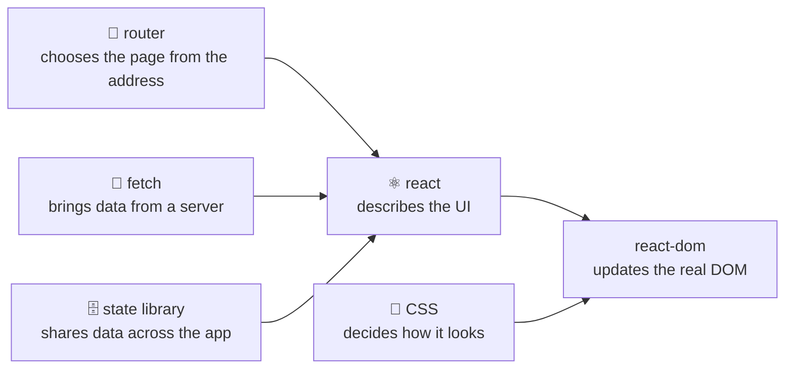

# What is not React

📘 **What is not React**

React describes your UI (user interface) and keeps it in step with your data. Almost everything else a real app needs, such as pages with their own addresses, colours and layout, and data from a server, comes from **other tools that work alongside React**. 🧺

---

**You will learn to:**

- list what React leaves to others: the real DOM (Document Object Model, the browser's live tree of the page) through `react-dom`, routing, styling, data fetching and global state
- recognise the difference between a **library** and a **framework**, and say which one React is
- route between two pages with React Router
- style a component with `className` and a CSS (Cascading Style Sheets) file, and with an inline `style`
- fetch data from a file and show it on the screen (a preview of Effects, lesson 5.1)

**Before you start:** [lesson 1.1, What is React](01-01-what-is-react.md) and [lesson 1.2, JSX: describing the UI](01-02-jsx-describing-the-ui.md). Example 3 uses `async` and `await`; Albert's [async page](https://albertprofe.dev/reactjs/reactjs-app-async.html) is a good refresher. ⏱️ About 40 minutes, exercises included.

## 1 Overview

Picture a stall at the Saturday market. The stall keeper arranges the fruit, swaps an empty crate for a full one and keeps the display honest when prices change. That is React's job: **describing the UI**, everything people see and touch on the screen, and keeping it up to date.

The stall keeper doesn't build the hall, paint the signs or drive the delivery van. Other people do, and the stall works because they do. 🚚

In [lesson 1.1](01-01-what-is-react.md#31-a-library-and-only-for-the-view) you saw Dave Ceddia's drawing of the two circles. Here it is again, because this whole lesson lives in the big orange one:


*What React does, and the much larger world of things it leaves to other tools. Image by [Dave Ceddia](https://daveceddia.com/what-react-does/), as used on Albert's [JSX page, §4](https://albertprofe.dev/reactjs/reactjs-what-jsx.html).*

Albert's JSX page, §4, quotes Ceddia on this. In short, React has no opinion at all about how things look. If you search for "how to centre a box in React", you are really asking a CSS question. 🎯

You also met **library** and **framework** in 1.1. A **library** is a set of tools *your* code calls when it needs them. A **framework** decides the structure of your app and calls *your* code. You'll still see React called a framework now and then, because the word is often used loosely for "a big tool". react.dev calls it a library, and so does this course. Some frameworks are *built on top of* React and make this lesson's choices for you. This course uses Vite instead and picks each neighbour by hand, so you can see the joins.

Here is React with its neighbours:



## 2 The problem: a recipe site with only React

Tom wants a small website for his kitchen. It needs three things:

1. Two pages, a home page and a recipe page, each with its own **URL** (Uniform Resource Locator, the address in the browser's bar, like `/recipes`).
2. Colours, borders and a bit of layout, so it doesn't look like a 1995 document.
3. Today's special, loaded from a file on a server, so he can change it without touching the code.

Open the `react` package and look for a "page" tool, a "colour" tool or a "download" tool. You won't find any. Here is who does each job:

| You need… | In the `react` package? | Who does it |
| --- | --- | --- |
| Putting elements into the real page | No | `react-dom`, React's partner package ([lesson 1.1](01-01-what-is-react.md)) |
| A page for each URL | No | A **router** library, such as React Router |
| Colours and layout | No | **CSS**, the browser's styling language |
| Data from a server | No | The browser's `fetch` function, or a data-fetching library |
| Data shared by the whole app | Partly | React's own reducer and context (lessons 4.1 and 4.2), or a state library such as [Redux](https://redux.js.org/) or [Zustand](https://zustand.docs.pmnd.rs/) |

**Global state** means data that many distant parts of an app need, like a shopping basket. You'll meet React's own tools for it in Module 04, so this lesson leaves it there.

None of this is a weakness. React does one job well and lets you choose the rest, the way a good knife doesn't try to be an oven. 🔪 react.dev's [Build a React App from Scratch](https://react.dev/learn/build-a-react-app-from-scratch) says the same thing: build tools like Vite give you a starting single-page app, but no ready-made answer for routing, data fetching or styling.

## 3 The solution: React plus a few good neighbours

Here is a short introduction to each neighbour. Sections 4–6 show each one working.

### 3.1 Routing: one page, many addresses

A Vite app is a **single-page application**, or SPA: the browser loads one HTML (HyperText Markup Language) file, `index.html`, and JavaScript draws everything after that. So how can `/recipes` show a different page?

A **router** reads the URL and decides which component to show. When you click one of its links, it changes the URL *without* asking the server for a new page, and React redraws only what changed. The page never blinks.

React has no router. react.dev's [routing section](https://react.dev/learn/build-a-react-app-from-scratch) explains what a router does and points to a few libraries. This lesson uses [React Router](https://reactrouter.com/), the one on Albert's [router page](https://albertprofe.dev/reactjs/reactjs-app-router.html). You add it with npm (Node's package manager):

```bash
npm install react-router
```

> [!NOTE]
> Albert's router page installs `react-router-dom`, the package name older versions used. Current versions ship everything in `react-router`, and version 8 removed `react-router-dom` altogether, so `react-router` is the name you'll use.

### 3.2 Styling: CSS's job, through two doors

The browser styles the page with CSS, so React gives you two doors into it:

- **`className`** connects an element to the rules in a CSS file. In [lesson 1.2](01-02-jsx-describing-the-ui.md) you saw why it's `className` and not `class`.
- **`style`** takes a JavaScript object of styles, written straight on the element. You used it in 1.2 to colour a title from data.

Which door do you use? react.dev's [guide to CSS styles](https://react.dev/reference/react-dom/components/common#applying-css-styles) recommends classes for most styling and the `style` attribute only when a value depends on your data.

How the CSS file reaches the browser isn't React's business either: react.dev says React doesn't dictate how you add CSS files. In a Vite project, you `import` the CSS file and Vite adds it to the page ([Vite's CSS guide](https://vite.dev/guide/features#css)). Albert's [styling page](https://albertprofe.dev/reactjs/reactjs-app-styling.html) shows a whole shelf of other options, such as Sass, Tailwind and Bootstrap. In the end the browser reads CSS, and React stays out of it. 🎨

### 3.3 Data fetching: asking the kitchen

Most apps get their data from a server through an **API** (Application Programming Interface), a set of addresses a program can ask for data. The request travels over **HTTP** (HyperText Transfer Protocol), the same protocol your browser uses for web pages, and the answer often comes back as **JSON** (JavaScript Object Notation), text that looks like a JavaScript object.

The browser already has a tool for this: [`fetch`](https://developer.mozilla.org/en-US/docs/Web/API/Fetch_API/Using_Fetch). It isn't React's. The tricky part is *when* to call it. A component's job is to return JSX quickly, and a network request takes time. React's answer is an **Effect**: code that runs *after* React has put the component on the screen. You'll study Effects properly in [lesson 5.1](05-01-effects.md). Here you'll only use one.

react.dev points out that real apps also need loading states, error states and **caching** (keeping answers so you don't ask twice), which purpose-built data libraries handle for you. Albert's [custom hooks page](https://albertprofe.dev/reactjs/reactjs-hook-custom.html) wraps the fetch in a reusable `useFetch` hook. This lesson stays with plain `fetch`, so you can see every part.

> [!IMPORTANT]
> React's job ends at **describing the UI**. Routers, CSS and `fetch` plug in through ordinary JavaScript: you import them, use them inside your components, and React keeps rendering as usual.

## 4 Example 1: two pages with React Router

Tom's site, with a home page and a recipe page. Open the [two-pages example on StackBlitz](https://stackblitz.com/github/AlbertProfe/React-curriculum/tree/drafts/examples/01-03/two-pages) (an online editor that runs the whole project in your browser), click **Recipes**, and watch the address change.

**`App.jsx`**

```jsx
import { BrowserRouter, Link, Route, Routes } from 'react-router';
import Home from './Home.jsx';
import Recipes from './Recipes.jsx';

export default function App() {
  return (
    <BrowserRouter>
      <nav>
        <ul>
          <li><Link to="/">🏠 Home</Link></li>
          <li><Link to="/recipes">📖 Recipes</Link></li>
        </ul>
      </nav>
      <Routes>
        <Route path="/" element={<Home />} />
        <Route path="/recipes" element={<Recipes />} />
      </Routes>
    </BrowserRouter>
  );
}
```

1. Everything comes from `react-router`, not from `react`. That one import line is the lesson in miniature.
2. `<BrowserRouter>` wraps the app. It watches the browser's address bar and tells everything inside it which URL is current.
3. `<Link to="/recipes">` draws a normal link, but when you click it, the router changes the URL *without* reloading the page.
4. `<Routes>` looks at the current URL and picks the first `<Route>` whose `path` matches it. That route's `element` is what appears.
5. The `<nav>` sits outside `<Routes>`, so it stays on screen for every page.

**`Home.jsx`**

```jsx
export default function Home() {
  return (
    <main>
      <h1>Tom's kitchen 🏠</h1>
      <p>Fresh from the Saturday market, cooked slowly.</p>
    </main>
  );
}
```

1. A page is an ordinary component. It doesn't know it's a page; the router decides when to show it. `Recipes.jsx` is the same, with a short list of dishes.

> [!TIP]
> Inside your app, use `<Link>` instead of `<a href>`. An `<a>` tag asks the server for a brand-new page, so the whole app restarts. A `<Link>` stays inside the single page.

## 5 Example 2: a styled stall

Cherries at the Saturday market, with a border, a green price and a little ripeness bar. 🍒 Open the [styled-stall example on StackBlitz](https://stackblitz.com/github/AlbertProfe/React-curriculum/tree/drafts/examples/01-03/styled-stall).

**`Stall.css`**

```css
.stall {
  max-width: 18rem;
  padding: 1rem;
  border: 2px solid darkred;
  border-radius: 12px;
  font-family: sans-serif;
}

.stall h2 {
  margin-top: 0;
}

.price {
  font-weight: bold;
  color: darkgreen;
}

.ripeness {
  height: 0.75rem;
  border-radius: 6px;
  background: #eee;
}

.ripeness-fill {
  height: 100%;
  border-radius: 6px;
  background: crimson;
}
```

1. This is plain CSS: nothing in it knows about React. Each rule starts with a **selector** (which elements it applies to), such as `.stall` for "every element with the class `stall`".
2. `.ripeness` is the grey track of the bar; `.ripeness-fill` is the red part that fills it.

**`Stall.jsx`**

```jsx
import './Stall.css';

const cherries = {
  name: 'Cherries from the Ebre valley',
  price: 7,
  ripeness: 80,
};

export default function Stall() {
  return (
    <article className="stall">
      <h2>🍒 {cherries.name}</h2>
      <p className="price">{cherries.price} € / kg</p>
      <p>Ripeness</p>
      <div className="ripeness">
        <div
          className="ripeness-fill"
          style={{ width: cherries.ripeness + '%' }}
        />
      </div>
    </article>
  );
}
```

1. `import './Stall.css';` hands the file to Vite, which adds the styles to the page. React never reads the CSS.
2. `className="stall"` links the `<article>` to the `.stall` rule. The same goes for `price`, `ripeness` and `ripeness-fill`.
3. The width of the red bar depends on data, so it goes in `style`. `cherries.ripeness + '%'` builds the text `"80%"`. Change `ripeness` to `30` and the bar shrinks.
4. The empty `<div />` closes itself, as every JSX tag must ([lesson 1.2](01-02-jsx-describing-the-ui.md)).

## 6 Example 3: today's special, from a JSON file

Tom keeps today's special in a small JSON file, and the app shows it. 🐟 Open the [todays-special example on StackBlitz](https://stackblitz.com/github/AlbertProfe/React-curriculum/tree/drafts/examples/01-03/todays-special).

**`public/special.json`**

```json
{
  "dish": "Suquet de peix",
  "stall": "Tom's fish stall",
  "price": 15
}
```

Vite serves every file in the `public/` folder at the root of the site, so this one lives at `/special.json` ([Vite's public directory](https://vite.dev/guide/assets#the-public-directory)). Because the file ships with the example, it works offline, with no outside API involved.

**`App.jsx`**

```jsx
import { useEffect, useState } from 'react';

async function loadSpecial() {
  const response = await fetch('/special.json');
  return response.json();
}

export default function App() {
  const [special, setSpecial] = useState(null);

  useEffect(function () {
    loadSpecial().then(setSpecial);
  }, []);

  if (special === null) {
    return <p>⏳ Asking the kitchen…</p>;
  }

  return (
    <main>
      <h1>Today's special 🐟</h1>
      <h2>{special.dish}</h2>
      <p>
        {special.price} € at {special.stall}
      </p>
    </main>
  );
}
```

1. `loadSpecial` is plain JavaScript, with no React in it. `fetch` asks for the file, `await` waits for the answer, and `response.json()` turns the JSON text into an object. An `async` function hands back a **promise**: a ticket for a value that will arrive later. 🎟️
2. `useState(null)` gives the component a memory slot called `special`, which starts empty. `setSpecial` fills it, and filling it makes React draw the component again. That's a preview: state is the subject of [lesson 3.1](03-01-state-component-memory.md).
3. `useEffect(function () { … }, [])` is the Effect. React runs the function *after* the component is on the screen, and the empty `[]` means "only after the first time". When the promise arrives, `.then(setSpecial)` puts the data into state.
4. On the first draw, `special` is still `null`, so the component returns the "Asking the kitchen" line. ⏳
5. On the second draw, the data is there, and you see the dish, the price and the stall.

> [!NOTE]
> Open the **Network** panel in your browser's developer tools and reload. In development you'll see `special.json` requested twice. That's React's `StrictMode` (the wrapper in `main.jsx`) running Effects twice to help you catch mistakes. The production build asks once. Lessons [1.5](01-05-purity.md) and [5.1](05-01-effects.md) explain why.

> [!WARNING]
> This example is a preview, not a pattern to copy into every app. It has no error state and no caching, and react.dev's [useEffect reference](https://react.dev/reference/react/useEffect#fetching-data-with-effects) adds a cleanup step it leaves out. You'll write it properly in 5.1.

## 7 Back to the whole: a market of neighbours

Step back to the market hall. In all three examples, React did the same job: it called your components and kept the screen in step with what they returned. Everything else came from a neighbour:

- **React Router** decided *which* component to show for the URL.
- **CSS**, imported by **Vite**, decided how the stall *looks*.
- **`fetch`**, a browser tool, brought the *data*, and an Effect decided *when* to ask.
- **`react-dom`**, in `main.jsx`, put the result into the real DOM, as in every example since 1.1.

That's the library way: React at the centre, with you choosing the neighbours. A framework would pick them for you; that's a trade between freedom and ready-made decisions, not right against wrong. The centre stays the same, and the rest of this course is about it. 🌳

As Dalí might put it, React paints the clocks; it doesn't decide how fast time melts. 🫠

## 8 Recap

- React describes the UI. `react-dom` puts it in the real DOM.
- Routing, styling, data fetching and global state are jobs for other tools.
- React is a **library**: your code calls it, and you choose its neighbours.
- A router maps URLs to components; `<Link>` changes the page without reloading.
- Style with `className` and a CSS file; use `style` when a value comes from data.
- `fetch` brings data; an Effect (lesson 5.1) decides when it runs.

## 9 Try it

Each exercise starts from one of the three examples on StackBlitz.

### 9.1 Find the lost stall 🔮

In **two-pages**, add a third link to the menu, `<li><Link to="/fish">🐟 Fish</Link></li>`, but don't add a route for it.

1. **Predict:** what will you see when you click **Fish**? Write it down, then click.
2. **Extend:** add a `NotFound.jsx` page and a route with `path="*"` (the router's "anything else") that shows it.

<details>
<summary>Solution</summary>

1. The URL changes to `/fish`, the menu stays, and the page area below it is empty. No `<Route>` matches, so `<Routes>` shows nothing. In the console, React Router warns: `No routes matched location "/fish"`.
2. Add a new page:

**`NotFound.jsx`**

```jsx
export default function NotFound() {
  return (
    <main>
      <h1>Lost in the market 🫠</h1>
      <p>This stall melted away, like one of Dalí's clocks.</p>
    </main>
  );
}
```

Then import it and add the catch-all route last:

**`App.jsx`**

```jsx
import { BrowserRouter, Link, Route, Routes } from 'react-router';
import Home from './Home.jsx';
import NotFound from './NotFound.jsx';
import Recipes from './Recipes.jsx';

export default function App() {
  return (
    <BrowserRouter>
      <nav>
        <ul>
          <li><Link to="/">🏠 Home</Link></li>
          <li><Link to="/recipes">📖 Recipes</Link></li>
          <li><Link to="/fish">🐟 Fish</Link></li>
        </ul>
      </nav>
      <Routes>
        <Route path="/" element={<Home />} />
        <Route path="/recipes" element={<Recipes />} />
        <Route path="*" element={<NotFound />} />
      </Routes>
    </BrowserRouter>
  );
}
```

Now **Fish**, and any other unknown address, lands on the melted stall.

</details>

### 9.2 Lemons, please 🍋

In **styled-stall**, turn the cherries into lemons at 3 € / kg. Lemons need a golden bar, not a red one. Add a `colour` to the data and use it in the bar's `style`.

<details>
<summary>Solution</summary>

**`Stall.jsx`**

```jsx
import './Stall.css';

const lemons = {
  name: 'Lemons from the garden',
  price: 3,
  ripeness: 80,
  colour: 'goldenrod',
};

export default function Stall() {
  return (
    <article className="stall">
      <h2>🍋 {lemons.name}</h2>
      <p className="price">{lemons.price} € / kg</p>
      <p>Ripeness</p>
      <div className="ripeness">
        <div
          className="ripeness-fill"
          style={{
            width: lemons.ripeness + '%',
            background: lemons.colour,
          }}
        />
      </div>
    </article>
  );
}
```

The colour depends on the data, so it goes in `style`, next to the width. Values in `style` win over the `.ripeness-fill` rule in the CSS file, so `Stall.css` doesn't change.

</details>

### 9.3 Predict the empty plate

In **todays-special**, change `'/special.json'` to `'/specials.json'` (with an extra *s*) in `App.jsx`, but don't rename the file. What will the screen show? What will the console show?

<details>
<summary>Solution</summary>

The screen stays on "⏳ Asking the kitchen…" forever. There is no `specials.json`, so Vite's development server answers with the app's `index.html` page instead. `response.json()` can't read HTML as JSON, so the promise fails, and the console shows an error like `Unexpected token '<', "<!doctype "... is not valid JSON`. `setSpecial` is never called, so `special` stays `null`.

That's the "error state" react.dev talks about: a real app would show a message instead of waiting forever. Data libraries, and the Effects lesson, help with that.

</details>

### 9.4 Draw the market 🎨

Without looking back, draw React in the middle of a page and its neighbours around it: `react-dom`, a router, CSS, `fetch` and a state library. Add one arrow for each, labelled with the job it does. Then compare with the diagram in section 1.

### 9.5 Debate in class 🗣️

1. React leaves routing, styling and data fetching to others. Is that freedom or homework?
2. This lesson used a router library. You could also write a small page switch yourself. When would a home-made switch be enough, and when would you want a library?

<details>
<summary>Some points to bring</summary>

1. Freedom: you pick tools that fit your project and can swap one without rewriting the rest. Homework: you must choose, learn and connect each tool, and keep them all up to date. Frameworks built on React take on that homework for you, in exchange for following their rules.
2. A home-made switch can be fine for two or three screens. A library earns its place once you need the back button and links people can bookmark to work everywhere, plus pages inside pages and addresses with values in them (such as `/recipes/escalivada`). react.dev lists those last two, nested routes and route parameters, as part of a router's job.

</details>

## References

- Albert: [ReactJS: what is JSX, §4](https://albertprofe.dev/reactjs/reactjs-what-jsx.html) (styling is not React's job)
- Albert: [React JS App: router](https://albertprofe.dev/reactjs/reactjs-app-router.html)
- Albert: [React JS App: styling](https://albertprofe.dev/reactjs/reactjs-app-styling.html)
- Albert: [React JS App: async](https://albertprofe.dev/reactjs/reactjs-app-async.html)
- Albert: [ReactJS: custom hooks](https://albertprofe.dev/reactjs/reactjs-hook-custom.html) (`useFetch`)
- react.dev: [Build a React App from Scratch](https://react.dev/learn/build-a-react-app-from-scratch) (routing, data fetching)
- react.dev: [Writing Markup with JSX](https://react.dev/learn/writing-markup-with-jsx) (`className`)
- react.dev: [Common components: applying CSS styles](https://react.dev/reference/react-dom/components/common#applying-css-styles)
- react.dev: [useEffect: fetching data with Effects](https://react.dev/reference/react/useEffect#fetching-data-with-effects)
- React Router: [Declarative mode installation](https://reactrouter.com/start/declarative/installation)
- Vite: [CSS](https://vite.dev/guide/features#css) and [the public directory](https://vite.dev/guide/assets#the-public-directory)
- MDN (Mozilla Developer Network): [Using the Fetch API](https://developer.mozilla.org/en-US/docs/Web/API/Fetch_API/Using_Fetch)
- Dave Ceddia: [What React Does (and Doesn't Do)](https://daveceddia.com/what-react-does/) (source of the "Things React does" image)
