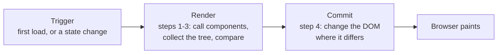
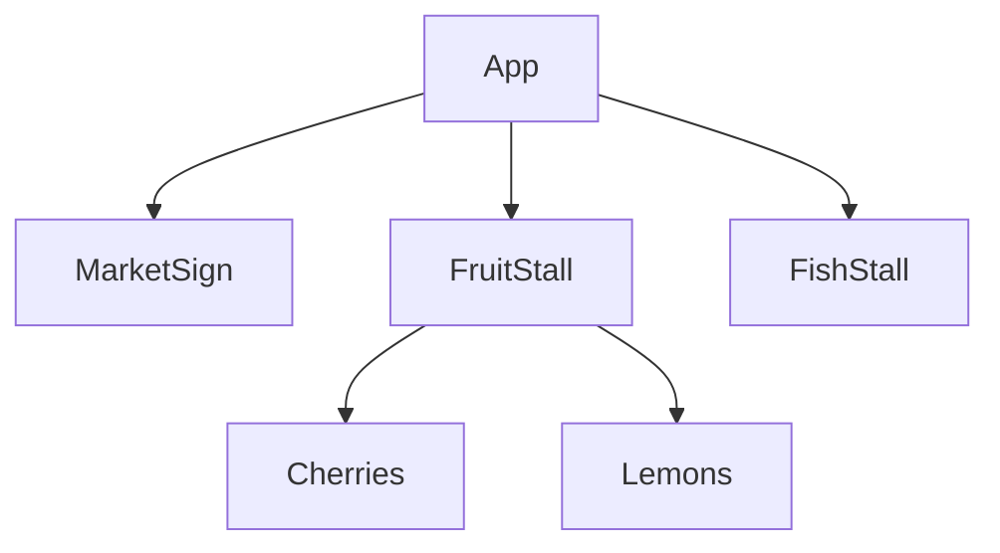
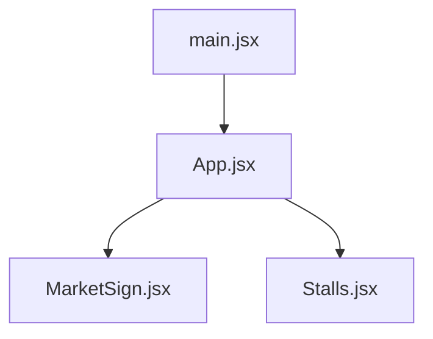

# React is a component tree rendering

📘 **Component tree rendering**

A React app is **one tree of components**, with your root component at the top. Rendering means React calls those components, works out what changed, and then touches only those parts of the page. 🌳

---

**You will learn to:**

- write a function component and split components into their own files with `export` and `import`
- choose between a **default** and a **named** export
- draw the **render tree** of a small app, and tell it apart from its **module tree**
- describe the four render steps in the course outline, [React.md](../React.md), and match them to react.dev's **trigger → render → commit**

**Before you start:** [lesson 1.1](01-01-what-is-react.md) (sections 3.2, components, and 3.4, the render cycle) and [lesson 1.2](01-02-jsx-describing-the-ui.md) (section 6, from JSX to the tree). If `import` and `export` are new to you, read Albert's [import modules page](https://albertprofe.dev/reactjs/reactjs-es6-import.html) first. ⏱️ About 40 minutes, exercises included.

## 1 Overview

Walk into a covered market on a Saturday morning. The hall holds the stalls, each stall holds its crates, and each crate holds the fruit. You can draw that as a tree: the hall at the top, branches to the stalls, smaller branches to the crates.

Your React app has the same shape. One **root component**, usually `App`, renders other components, which render more components, down to the small ones at the tips. React.md puts it in one line: **the whole application is one big component tree.**

This lesson does three things with that tree. You split it into files, you draw it, and you watch React walk it when something changes.

## 2 The problem: one file, one long morning

In lesson 1.1 the whole stall lived in one `App.jsx`. That's fine for two products. Now picture the full market: a sign at the entrance, a fruit stall, a fish stall, a cheese stall, each with its own products. Put everything in `App.jsx` and you get a file you have to scroll for minutes, where every change means hunting for the right function.

There is a second, quieter problem. When one number on the screen changes, say the count of customers, what does React actually do? Does it rebuild the whole market? Does your half-typed name in a form survive? You can't answer that until you can **see the tree** React works with.

## 3 The solution: components, files and the tree

### 3.1 A component, once more

You met components in [lesson 1.1, section 3.2](01-01-what-is-react.md#32-components-the-stalls-of-your-market). The recipe has three parts:

1. a JavaScript `function` whose name starts with a **capital letter**
2. that **returns JSX** (the HTML-like syntax from [lesson 1.2](01-02-jsx-describing-the-ui.md)), the description of a piece of UI (user interface)
3. and is **used** inside other components as a tag: `<MarketSign />`


*Define, use, export: the life of a component. Image from Albert's [components page, §4](https://albertprofe.dev/reactjs/reactjs-what-components.html#using-a-component).*

One rule is new: **define every component at the top level of a file**, never inside another component. React's docs warn that a component defined inside another one is slow and causes bugs ([Your First Component](https://react.dev/learn/your-first-component#nesting-and-organizing-components)). You'll see one of those bugs with your own eyes in exercise 8.3.

> [!NOTE]
> Albert's [components page, §5](https://albertprofe.dev/reactjs/reactjs-what-components.html#writing-a-component) shows three ways to write and export the same component. They all work the same. This course uses `export default function Name()` and plain `function` declarations everywhere.

### 3.2 Export and import: moving a stall to its own file

A component in its own file is easier to find and to reuse. Moving one takes three steps, as Albert's [import modules page](https://albertprofe.dev/reactjs/reactjs-es6-import.html) shows: make a new file, **export** the component from it, and **import** it where you use it.

JavaScript gives you two kinds of export:

| Kind | In the component's file | Where you use it |
| --- | --- | --- |
| Default | `export default function MarketSign() {}` | `import MarketSign from './MarketSign.jsx';` |
| Named | `export function FishStall() {}` | `import { FishStall } from './Stalls.jsx';` |

Two facts to remember:

- A file can have **one** default export, and as many named exports as you like.
- With a default import you choose the name. With a named import, the name in the curly braces must **match** the export.

A common habit, which react.dev also describes: default export when the file holds one component, named exports when it holds several ([Default vs named exports](https://react.dev/learn/importing-and-exporting-components#default-vs-named-exports)).

### 3.3 Two trees from one app

Now draw the app. You can draw two different trees, and both are useful.

The **render tree** has one node per component that React renders. The root is your root component. There are no `<h1>` or `<ul>` nodes in it: react.dev leaves the HTML (HyperText Markup Language) tags out because React also runs in places with no HTML at all, such as mobile or desktop apps ([The Render Tree](https://react.dev/learn/understanding-your-ui-as-a-tree#the-render-tree)). In 1.2 you drew the tree of elements, tags included; the render tree zooms out to components only.

Two names for positions in it:

- **top-level components** sit close to the root. They affect how fast everything below them renders.
- **leaf components** have no child components. They are often re-rendered frequently.

The **module tree** (react.dev calls it the [module dependency tree](https://react.dev/learn/understanding-your-ui-as-a-tree#the-module-dependency-tree)) has one node per **file**, and each branch is an `import`. Its root is the entry file, `main.jsx` in a Vite project (Vite is the build tool you met in [lesson 1.1](01-01-what-is-react.md)). Files that hold no component, such as a list of prices, appear in it too. Build tools use this tree to decide which files go into the code the browser downloads.

The render tree is about **what is on the screen right now**. The module tree is about **how your code is stored**. Example 1 shows the same app as both.

### 3.4 Rendering the tree: trigger, render, commit

React.md lists four steps for what happens when React renders:

1. it calls your components
2. it collects the tree of elements they return
3. it compares that tree with the previous one
4. it applies the smallest set of changes to the host, which for you is the browser's DOM (Document Object Model, the live tree of the page)

You followed those four steps through a click in [lesson 1.1, section 3.4](01-01-what-is-react.md#34-the-render-cycle). react.dev groups them under three names, and from now on this course uses those names too ([Render and Commit](https://react.dev/learn/render-and-commit)):



- **Trigger.** There are two reasons to render. The first is the initial load, when `main.jsx` calls `createRoot(...).render(<App />)`. The second is a state change in a component, or in one of its parents.
- **Render.** On the first load, React calls the root component and creates the DOM nodes for everything it returns. On later renders, it calls the component whose state changed, and works out which parts differ from last time. Either way it keeps going **down the tree**: if a component returns `<NameTag />`, React calls `NameTag` too, and so on to the leaves.
- **Commit.** On the first load, React puts all the DOM nodes it created onto the page. On later renders it applies **only the changes it worked out during render**, and leaves the rest alone.

Then the browser **paints** the screen. react.dev uses the word *painting* for this step, to keep it apart from React's render.

> [!NOTE]
> The examples' `main.jsx` wraps `<App />` in `<StrictMode>`. In development, Strict Mode makes React call each component function **twice**, to help you find mistakes. You'll see why that matters in [lesson 1.5](01-05-purity.md).

> [!TIP]
> A market picture to hold on to: **trigger** is a price change. **Render** is Tom rewriting his price list on a notepad and checking it against yesterday's. **Commit** is him walking to the stall and replacing only the labels that changed, not every sign in the hall. 🏷️

You may still see the tree React keeps in memory called the **virtual DOM**, and the comparison called *diffing*, as in 1.1 section 6 and Albert's [render and virtual DOM page](https://albertprofe.dev/reactjs/reactjs-what-render-dom.html). These are community words; react.dev's Render and Commit page doesn't use them. Treat them as background. Trigger, render and commit are the words to think with, and [lesson 3.2](03-02-render-and-commit.md) takes them further.

## 4 Example 1: the market hall in three files

Here is the market split into files: open [market-hall on StackBlitz](https://stackblitz.com/github/AlbertProfe/React-curriculum/tree/drafts/examples/01-04/market-hall) (the online editor that runs the whole project in your browser). The `main.jsx` file is the same one you met in 1.1, so it isn't shown again.

**`App.jsx`**

```jsx
import MarketSign from './MarketSign.jsx';
import { FishStall, FruitStall } from './Stalls.jsx';

export default function App() {
  return (
    <main>
      <MarketSign />
      <FruitStall />
      <FishStall />
    </main>
  );
}
```

**`MarketSign.jsx`**

```jsx
export default function MarketSign() {
  return <h1>🧺 Saturday market</h1>;
}
```

**`Stalls.jsx`**

```jsx
function Cherries() {
  return <li>🍒 Cherries · 7 € / kg</li>;
}

function Lemons() {
  return <li>🍋 Lemons · 3 € / kg</li>;
}

export function FruitStall() {
  return (
    <section>
      <h2>Fruit stall</h2>
      <ul>
        <Cherries />
        <Lemons />
      </ul>
    </section>
  );
}

export function FishStall() {
  return (
    <section>
      <h2>Fish stall</h2>
      <p>🐟 Hake · 15 € / kg</p>
    </section>
  );
}
```

1. `MarketSign.jsx` holds one component, so it uses a **default export**. `App` imports it with no curly braces.
2. `Stalls.jsx` holds two stalls that `App` needs, so both are **named exports**. `App` imports them by name, inside curly braces.
3. `Cherries` and `Lemons` have no `export`. Only `FruitStall` uses them, so they stay private to their file.
4. Every component is defined at the top level of its file. None sits inside another.

You see a heading, then the fruit stall with two products, then the fish stall.

<!-- screenshot: the market-hall example in the browser, showing the sign, the fruit stall with cherries and lemons, and the fish stall -->

Now draw it. First the **render tree**, components only:



`MarketSign`, `FruitStall` and `FishStall` are the **top-level** components. `MarketSign`, `Cherries`, `Lemons` and `FishStall` are **leaves**.

Then the **module tree**, files and imports:



Compare them. `Cherries` and `Lemons` are in the render tree but have no box of their own in the module tree, because they live inside `Stalls.jsx`. And `main.jsx` is in the module tree but not in the render tree, because it holds no component: it only starts React.

## 5 Example 2: commit changes only what differs

Time to watch the tree render. This example uses `useState`, the Hook you read in 1.1 and study properly in [lesson 3.1](03-01-state-component-memory.md): [commit-only-changes on StackBlitz](https://stackblitz.com/github/AlbertProfe/React-curriculum/tree/drafts/examples/01-04/commit-only-changes).

**`App.jsx`**

```jsx
import { useState } from 'react';
import NameTag from './NameTag.jsx';

export default function App() {
  const [customers, setCustomers] = useState(0);

  function handleArrive() {
    setCustomers(customers + 1);
  }

  return (
    <main>
      <h1>Customers today: {customers}</h1>
      <button onClick={handleArrive}>🛒 One more customer</button>
      <NameTag />
    </main>
  );
}
```

**`NameTag.jsx`**

```jsx
export default function NameTag() {
  return (
    <p>
      <label>
        Your name for the queue: <input />
      </label>
    </p>
  );
}
```

1. `App` keeps a count of customers in state and shows it in the heading.
2. Each click calls `handleArrive`, which asks React to set the count to one more.
3. `NameTag` is a separate component, in its own file, with an `<input>` you can type into.

Type your name into the box, then click the button a few times. The count goes up, and **your name stays**. 🙂

<!-- screenshot: the commit-only-changes example after typing a name and clicking three times, with "Customers today: 3" and the name still in the box -->

Follow one click through the steps:

1. **Trigger:** the click calls `setCustomers`, and `App`'s state changes.
2. **Render:** React calls `App`, and because `App` returns `<NameTag />`, it calls `NameTag` as well. Both functions run again. React compares the new tree with the old one: only the heading's text is different. `NameTag` returned the same `<input>` in the same place.
3. **Commit:** React updates the heading's text and nothing else. It **keeps the input it already has**, with your typing inside.

So "React re-rendered `NameTag`" does **not** mean "React rebuilt the box". Rendering is calling functions; changing the page happens only at commit, and only where needed. react.dev's [Render and Commit](https://react.dev/learn/render-and-commit#step-3-react-commits-changes-to-the-dom) page shows the same thing with a clock and a text box.

Check it yourself. Open your browser's developer tools (F12 in Chrome), go to the **Console** tab, and type `const box = document.querySelector('input')`. Click the button, then type `box === document.querySelector('input')`. You get `true`: the same input node, before and after.

## 6 Back to the whole: one tree, rendered again and again

Put both examples side by side and you have React.md's idea:

- You **describe** the UI as components, in as many files as you like. The module tree is how you store them.
- React **renders** that description as a tree, starting from the root. The render tree is what it walks.
- Each **trigger** makes React call components from the changed one down, compare, and **commit** the differences.

That last point explains several rules you'll meet later. Components should give the same output for the same input, because React may call them often: that's purity, the topic of [lesson 1.5](01-05-purity.md). Data flows down the tree through props in [lesson 2.1](02-01-passing-props.md). And the exact moment of render and commit is [lesson 3.2](03-02-render-and-commit.md).

## 7 Recap

- A component is a capitalised `function` that returns JSX. Define it at the top level of a file.
- **Default export:** one per file, imported with any name. **Named exports:** many per file, imported by their exact name in `{ }`.
- The **render tree** has components only, with the root component on top; the **module tree** has files linked by `import`, with the entry file on top.
- React.md's four steps fit into **trigger → render → commit**: rendering is React calling your components and working out what changed; commit changes only the DOM nodes that differ; then the browser paints.

## 8 Try it

Exercises 8.1 to 8.4 use the two examples. Fork them on StackBlitz, or download them and run `npm install` and `npm run dev` (npm is the package manager that comes with Node.js).

### 8.1 Open a flower stall 💐

In **market-hall**, add a `FlowerStall` component in a new file, `FlowerStall.jsx`, with a default export. It shows the heading "Flower stall" and one paragraph: "🌻 Sunflowers · 2 € each". Render it after the fish stall. Then update both trees.

<details>
<summary>Solution</summary>

**`FlowerStall.jsx`**

```jsx
export default function FlowerStall() {
  return (
    <section>
      <h2>Flower stall</h2>
      <p>🌻 Sunflowers · 2 € each</p>
    </section>
  );
}
```

In `App.jsx`, add `import FlowerStall from './FlowerStall.jsx';` with the other imports and `<FlowerStall />` after `<FishStall />`. The render tree gets one new leaf, `FlowerStall`, under `App`. The module tree gets one new file, `FlowerStall.jsx`, under `App.jsx`.

</details>

### 8.2 Predict: a lowercase sign 🔮

In `App.jsx`, change `<MarketSign />` to `<marketSign />`. What do you see, and why?

<details>
<summary>Answer</summary>

The sign disappears. A lowercase tag tells React "this is an HTML tag", so React asks the browser for an element called `marketsign`, which shows nothing. Your component never runs. In Chrome's console, React logs two errors: one says that `<marketSign />` is using incorrect casing ("Use PascalCase for React components, or lowercase for HTML elements"; PascalCase means a capital letter at the start of every word) and the other that the tag is unrecognized in this browser. The fix is the capital letter.

</details>

### 8.3 Predict: a stall inside a stall ❌

In **commit-only-changes**, someone moves `NameTag` inside `App` to "keep things together":

**`App.jsx`**

```jsx
import { useState } from 'react';

export default function App() {
  const [customers, setCustomers] = useState(0);

  function NameTag() { // ❌ defined inside App
    return (
      <p>
        <label>
          Your name for the queue: <input />
        </label>
      </p>
    );
  }

  function handleArrive() {
    setCustomers(customers + 1);
  }

  return (
    <main>
      <h1>Customers today: {customers}</h1>
      <button onClick={handleArrive}>🛒 One more customer</button>
      <NameTag />
    </main>
  );
}
```

Type your name and click. What happens to your name? Try it to check.

<details>
<summary>Answer</summary>

Your name is wiped on every click. Each render of `App` creates a **brand-new** `NameTag` function. When React compares the trees, it finds a different component in the same place. So it removes the old `NameTag` and everything below it, state and DOM nodes included, and creates a new one with an empty box. react.dev puts it this way: a different component in the same position resets all the state below it ([Preserving and Resetting State](https://react.dev/learn/preserving-and-resetting-state#different-components-at-the-same-position-reset-state)). The `box === document.querySelector('input')` check from section 5 now gives `false`. The fix is the original code: `NameTag` at the top level of its own file. [Lesson 3.8](03-08-preserving-resetting-state.md) explains this rule in depth.

</details>

### 8.4 Draw both trees 🎨

On paper, draw the render tree and the module tree of **commit-only-changes**. Which components are leaves?

<details>
<summary>Solution</summary>

Render tree: `App` with one child, `NameTag`. Module tree: `main.jsx` → `App.jsx` → `NameTag.jsx`. `main.jsx` also imports from the `react` and `react-dom/client` packages, and `App.jsx` from `react`. `NameTag` is the only leaf.

</details>

### 8.5 Debate in class 🗣️

1. Why does the render tree leave out the HTML tags?
2. One component per file, or several small ones together?

<details>
<summary>Some points to bring</summary>

1. React itself doesn't know about HTML; `react-dom` does. The same tree of components could be shown by another host, such as a mobile app. And for most questions ("what re-renders when this changes?"), components are the useful level.
2. One per file is quick to find and to import anywhere. Small, private helpers like `Cherries` can sit next to the only component that uses them, as react.dev also allows. Move one out when a second file needs it.

</details>

## References

- Albert: [ReactJS: what are components](https://albertprofe.dev/reactjs/reactjs-what-components.html) (source of the "component-using" image)
- Albert: [ReactJS: ES6 import modules](https://albertprofe.dev/reactjs/reactjs-es6-import.html)
- Albert: [React JS: render virtual DOM](https://albertprofe.dev/reactjs/reactjs-what-render-dom.html) (background only)
- react.dev: [Your First Component](https://react.dev/learn/your-first-component) ([nesting and organizing components](https://react.dev/learn/your-first-component#nesting-and-organizing-components))
- react.dev: [Importing and Exporting Components](https://react.dev/learn/importing-and-exporting-components) ([default vs named exports](https://react.dev/learn/importing-and-exporting-components#default-vs-named-exports))
- react.dev: [Understanding Your UI as a Tree](https://react.dev/learn/understanding-your-ui-as-a-tree) ([the render tree](https://react.dev/learn/understanding-your-ui-as-a-tree#the-render-tree), [the module dependency tree](https://react.dev/learn/understanding-your-ui-as-a-tree#the-module-dependency-tree))
- react.dev: [Render and Commit](https://react.dev/learn/render-and-commit)
